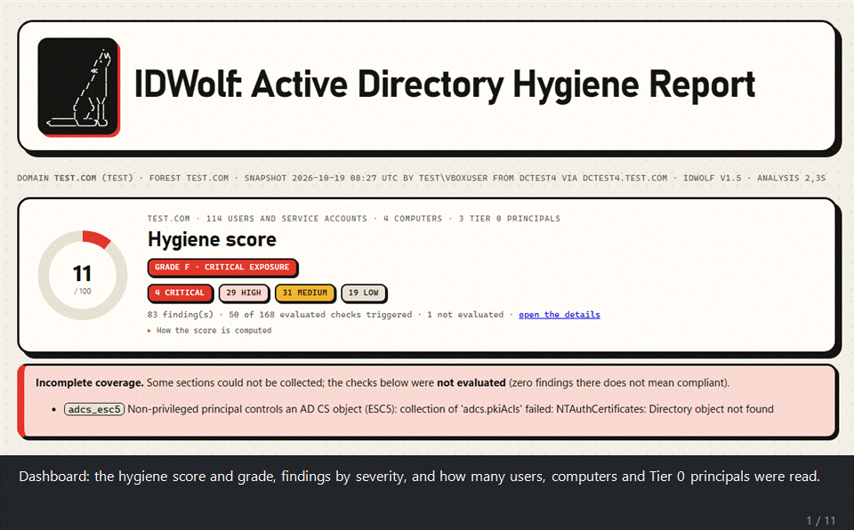

```
                     .
                    / V\
                  / `  /
                 <<   |                IDWolf
                 /    |                Active Directory / Entra hygiene
               /      |
             /        |
           /    \  \ /
          (      ) | |
  ________|   _/_  | |
<__________\______)\__)
```

[](LICENSE)
[](https://www.bestpractices.dev/projects/15416)



*A real report from a throw-away lab domain: the score, the charts, the AI summary
with its verdict on chaining the findings into domain compromise, the attack vectors
seen in recent attacks, the attack-path map, the Tier 0 members and the findings.*

IDWolf is tested on a real Active Directory lab, not only on synthetic data: a
domain populated with [Vulnerable-AD](https://github.com/safebuffer/vulnerable-AD)
and with the project's own scripts in `tests/lab/`, which plant ACL chains,
delegation and other misconfigurations.

IDWolf is a hygiene audit for Active Directory and Microsoft Entra ID, written
in plain PowerShell. It takes a **read-only snapshot** of your directory using
nothing but the native ActiveDirectory module, then analyzes that snapshot
**offline** and gives you an HTML report, a findings CSV and, if you want, JSON
Lines for your SIEM.

On the AD side it runs **169 checks**: Kerberos, privileged access, account
hygiene, domain configuration, permissions, DNS, AD CS (ESC1-5, 9, 10, 13, 15),
operational health (replication, DHCP, backups), host hardening read from the
GPOs (SMB and LDAP signing, NTLM, LM hash, user rights) and password quality,
all without ever handling a password hash. A separate collector covers
**Microsoft Entra ID** with **90 checks**, mapped to the CIS Microsoft 365
benchmark.

If you like, a Gemini step can write an executive summary and a remediation
plan. The findings themselves are always computed on your machine, and every
directory name is replaced by a token before anything is sent.

## What it looks like

The report is one self-contained HTML file, built to be read by the people who
have to act on it, not only by the person who ran the audit. A dashboard tab has
a score and a grade, an attack-path map and a trust map drawn as SVG, the Tier 0
members, NIS2 / ISO 27001 / DORA / GDPR cards, categories, top risks and charts;
a details tab has every finding with its fix. No
external libraries, no CDN, nothing loaded from the internet: it opens offline
and can be mailed as it is.

GitHub shows HTML files as plain text, so download the samples and open them in
a browser:

- `examples/lab_report.html` is the report in the GIF. It comes from the lab
  domain (populated with Vulnerable-AD and the `tests/lab/` scripts) and
  includes the optional Gemini summary.
- `examples/demo_report.html` is built on a fictional domain, with
  a deep collection and password quality. Its findings CSV and JSON Lines sit
  next to it.
- `examples/entra_report.html` is the fictional Entra tenant.

## The pieces

| Script | Runs on | Needs | Produces |
|---|---|---|---|
| `Start-IDWolf.ps1` (or `Start-IDWolf.cmd`) | anywhere | nothing | a menu for everything below |
| `Collect-ADSnapshot.ps1` | a domain-joined machine | ActiveDirectory module (RSAT), a domain account | AD snapshot JSON |
| `Collect-EntraSnapshot.ps1` | any machine | Microsoft Graph SDK, Global Reader | Entra snapshot JSON |
| `Export-PasswordQuality.ps1` | any machine that can reach the PDC (trusted admin host or DC), or an offline NTDS.dit | DSInternals, DCSync rights | password-quality JSON (no hashes) |
| `IDWolf.ps1` | anywhere | nothing | HTML + CSV + JSONL report |
| `Export-BloodHound.ps1` | anywhere | nothing | BloodHound CE zip (beta) |
| `Invoke-IDWolfScheduled.ps1` | a scheduled task | as the collector | collect + analyze with no prompts, a SIEM feed |

You don't have to tell `IDWolf.ps1` whether a snapshot is AD or Entra. It
works that out by itself.

## What IDWolf covers

| Area | Checks | What's in it |
|---|---|---|
| Kerberos | 14 | Kerberoasting, AS-REP roasting, RC4/DES, delegation (unconstrained, constrained, RBCD, orphan targets open to SPN-jacking), krbtgt age, Protected Users |
| Privileged access | 18 | Tier 0 membership by SID through nesting and primary group, dormant / foreign / computer admins, operator groups, DnsAdmins, RID 500, silos, GPOs making everyone local admin, RODC password replication policy and Tier 0 credentials cached on RODCs |
| Account hygiene | 19 | inactive and never-used accounts, passwords not required / never expiring / in descriptions, sIDHistory, LAPS deployment and rotation, obsolete OS |
| Domain configuration | 28 | password policies and FGPPs, functional level, Recycle Bin, anonymous LDAP, trusts, DNS zones and WPAD records, DC hygiene |
| Permissions | 17 | DCSync rights, dangerous ACEs on Tier 0 (or anywhere with `-Deep`: including write access to logon script, profile path, certificate mapping, account flags and account restrictions, the RBCD attribute), owners, DirSync readers of confidential attributes (SyncLAPSPassword), GPP passwords, script secrets, gMSA and LAPS readers, Shadow Credentials, dMSA creation rights (BadSuccessor), write access to the SCCM System Management container, GPO takeover, GPO scripts and tasks run from shares |
| Certificate services | 19 | ESC1-5, 9, 10, 13, 15, 17 (WSUS over HTTPS), weak CA keys, expiring CAs; ESC6, 7, 8, 11 and 16 read on the CA itself (admin rights on the CA host), with a manual-look note for any CA that could not be read |
| Host hardening (GPO) | 40 | SMB/LDAP signing and channel binding, NTLM/LM, WDigest, LSA protection, audit policy, logging, ZeroLogon, LLMNR, mDNS, NBT-NS (live on DCs), null sessions, Spooler, WebClient (GPO and live on DCs), noPac patch level and coercion interfaces (live on DCs), Point and Print (PrintNightmare), cached logons, AlwaysInstallElevated, autologon passwords in GPOs, WSUS over HTTP, RDP (NLA, Restricted Admin), Credential Guard, application control, IPv6 / mitm6, WPAD auto-discovery, Windows Script Host, force logoff |
| Password quality | 5 | duplicate, empty, default, breached and reversible passwords, without ever handling a hash |
| Operational health | 9 | replication, backups, DHCP on a DC, FSMO holders, unreachable DCs, clock skew between DCs, disk space and stopped services on DCs |
| **Entra ID** | 90 | MFA (registration, strength, Authenticator settings), Conditional Access (legacy auth, device code, risk, managed devices, locations, token protection, session limits), PIM (standing access, approval, activation and assignment settings, PIM for Groups owners), admins (cloud-only, licences, inactive, emergency access), devices (join, local admins, LAPS, BitLocker), guests, apps (consent, permissions, credential policy), password settings, risky app consents, app owners, groups behind Conditional Access exclusions and admin roles, the Entra Connect app, look-alike app names, credentials on Microsoft apps, sync health, federation, B2B direct connect, access packages and the roles on their catalogs, apps still on the retired Azure AD Graph, workload identity Conditional Access, Intune roles that can run code on devices and Multi Admin Approval for device wipes and scripts (not yet verified on a real tenant); every CIS Microsoft 365 v7 control that Graph can read |

The full list of checks is further down. How they map to CIS, PingCastle, the
InfosecMatter Top 16 and common attack techniques is in [`COVERAGE.md`](COVERAGE.md).

### Recent attacks

The vectors behind the most cited incidents and research of 2023-2026, and the
checks that look for the condition each one needs. The full table, including
what isn't covered (flaws on Microsoft's side, detection rather than configuration), is in
[`COVERAGE.md`](COVERAGE.md#recent-attacks-2023-2026).

| Attack | When | Checks |
|---|---|---|
| BadSuccessor (dMSA on Windows Server 2025, CVE-2025-53779) | 2025 | `badsuccessor_dmsa_create` |
| Golden dMSA / Golden gMSA | 2025 | `kds_root_key_readable` (`-Deep`) |
| Coercion + NTLM relay to LDAP or AD CS (CVE-2025-24054) | 2025-26 | `coercion_unfiltered_dc`, `adcs_esc8`, `adcs_esc11`, `ldap_signing_not_required`, `ldap_channel_binding_off`, `webclient_on_dc` |
| NTLM reflection over SMB (CVE-2025-33073) | 2025 | `smb_signing_not_required`, `smb_client_signing_not_required` (the mitigation) |
| AD CS ESC15 (EKUwu) and ESC16 | 2024-25 | `adcs_esc15`, `adcs_esc16` |
| AD CS ESC17: WSUS over HTTPS with a certificate anyone can request | 2026 | `adcs_esc17`, `wsus_http` |
| SCCM / MECM: rogue management point published in AD | 2023-26 | `sccm_system_management_writable` |
| Kerberoasting in ransomware intrusions | 2026 | `kerberoastable_user`, `privileged_kerberoastable`, `spn_account_rc4` |
| Entra Connect and SyncJacking | 2025-26 | `entra_admin_synced_from_onprem`, `entra_connect_app_extra_credentials`, `dcsync_rights` (partial) |
| Password spraying (over 99% of cloud initial access, Microsoft 2026) | 2025-26 | `entra_smart_lockout_weak`, `entra_banned_passwords_off`, `entra_legacy_auth_allowed`, `entra_admins_without_mfa` |
| Device code phishing | 2025-26 | `entra_device_code_flow_allowed` |
| Adversary-in-the-middle and token theft | ongoing | `entra_no_phishing_resistant_admins`, `entra_token_protection_off`, `entra_admin_sign_in_frequency` |
| OAuth consent phishing, over-privileged apps (Midnight Blizzard) | 2024-26 | `entra_users_can_consent`, `entra_risky_delegated_grant`, `entra_app_high_privilege` |
| Escalation through service principal ownership (Entra Agent ID) | 2026 | `entra_privileged_app_sp_owner`, `entra_privileged_app_owner` |
| Mass device wipe from a compromised Intune admin (Stryker, reported) | 2026 | `entra_intune_no_multi_admin_approval`, `entra_intune_role_weak_group` (not yet verified on a real tenant) |
| Apps still on Azure AD Graph (Actor token flaw, CVE-2025-55241) | 2025 | `entra_app_azure_ad_graph` |

### Regulations

Every check is mapped to the controls it gives evidence for, in four
frameworks:

| Framework | Controls |
|---|---|
| NIS2, Directive (EU) 2022/2555 (in Italy, Art. 24 of Legislative Decree 138/2024) | Art. 21(2)(b), (c), (e), (g), (h), (i), (j) |
| ISO/IEC 27001:2022, Annex A | A.5.15-A.5.18, A.8.2, A.8.5, A.8.8, A.8.9, A.8.13-A.8.16, A.8.20, A.8.24 |
| DORA, Regulation (EU) 2022/2554 | Art. 9(2), 9(4)(b), (c), (d), (f), 10(1), 12(1) |
| GDPR, Regulation (EU) 2016/679 | Art. 32(1)(a), (b), (c) |

The report shows, for each control, how many checks cover it, how many could not
be evaluated and what was found. Each check lists its controls, and the CSV
and JSON Lines carry them too. Controls with no IDWolf check say so (for
example NIS2 21(2)(j), multi-factor authentication, in an AD report). This is
evidence for the technical, directory-side part of each control. It doesn't
make anyone compliant: policies, processes, people and other systems are
outside a directory snapshot. The full table, with the reasoning, is in
[`COVERAGE.md`](COVERAGE.md#regulations).

## How it compares

These are the tools people usually reach for to do a similar job, in their free
or community editions. The table is based on their public documentation as of
October 2026. If something here is out of date or wrong, please say so.

| | IDWolf | PingCastle | Purple Knight | BloodHound CE | Locksmith | Maester | ADScan |
|---|---|---|---|---|---|---|---|
| What it is | AD + Entra hygiene audit | AD (and Entra) health check | AD, Entra, Okta exposure assessment | attack-path graph | AD CS scanner and fixer | Entra / M365 test framework | AD pentest tool (enumerates, then exploits) |
| Shape | readable PowerShell scripts | compiled .NET program | compiled program | server with web UI, plus collectors | PowerShell | PowerShell (Pester) | Python CLI (Docker on Linux / macOS, bundled exe on Windows), source-available (BSL 1.1) |
| Proves it can't write to the directory (built-in code review) | **Yes** | – | – | – | – (has a fix mode) | – | – (attacks by design, after operator confirmation) |
| Collect once, analyze later on another machine, offline | **Yes** | partial (re-renders its XML report) | – | yes (import into the server) | – | – | – |
| AI summary, remediation plan, attack-path story, fix scripts, exploitability ranking | **Yes** (names tokenized first, nothing sent without consent) | – | – | – | – | – | – |
| AD hygiene checklist | 169 checks | yes | yes | – (paths, not a checklist) | – | – | – (104 attack techniques, tried rather than audited) |
| AD CS (ESC) | ESC1-5, 9, 10, 13, 15; 6, 7, 8, 11, 16 read on the CA | some | some | yes, as graph edges | **broadest**, with fixes | – | template enumeration; ESC1-16 exploitation in PRO |
| Password quality (duplicates, breached) | yes, hashless | – | – | – | – | – | spraying and cracking (an attack, not an audit) |
| Host hardening read from GPOs | yes | yes | yes | – | – | – | – (some preconditions probed live) |
| DC health | replication, backup age, FSMO holders, reachability, clock skew, disk space, stopped services | backup age, DC registration, DCs not updated | ? | – | – | – | – |
| Entra ID | 90 checks, CIS M365 v7 + non-human identities | **102 checks** (4.0; the list isn't public, so the overlap with IDWolf is unknown) | yes | yes (AzureHound) | – | **broadest** (CIS, CISA, EIDSCA) | – |
| Attack-path view | map in the report + BloodHound export | control-path map | – | **the reference** | – | – | BloodHound CE-compatible collection; attack graph and exploitation chains in PRO |
| Report | **one self-contained HTML** (charts, attack-path and trust maps, compliance view, no CDN), CSV, JSONL | HTML | ? | web UI | console, CSV | HTML | TXT / JSON; PDF (with NIS2 / ISO 27001 mapping) in PRO |

A "–" means the feature isn't in that tool's free edition as far as I know, not
that it's impossible. A "?" means I couldn't find a public list to compare
against.

Where the others are stronger, use them next to IDWolf: BloodHound to explore
attack paths, Locksmith to fix AD CS, Maester or PingCastle for deeper Entra and
Microsoft 365 coverage, ADScan (with written authorization) to prove that a
weakness IDWolf reports can really be exploited. What IDWolf tries to be is one readable snapshot that
you can show is read-only, that someone else can analyze offline, with an AI
layer for the people who have to read the report.

Thinking of running it on a server or a DC? [`SECURITY.md`](SECURITY.md)
explains what it does and doesn't do, and how to check that yourself.
`.\Test-IDWolfSafety.ps1` reads the code without running it, lists every
command, every write and every network address, and fails on anything that
could change the directory.

### Against the commercial platforms

IDWolf is not a competitor to the commercial identity-security platforms: it is
a free, point-in-time check, while they are continuous products with real-time
detection, response and vendor support. The table is based on public
documentation as of October 2026; pricing and details change often.

| | IDWolf | Microsoft Defender for Identity | Semperis DSP | Tenable Identity Exposure |
|---|---|---|---|---|
| What it is | AD + Entra hygiene audit, point in time | ITDR: identity threat detection | AD/Entra posture + detection + recovery | AD/Entra exposure management, continuous |
| Licence / cost | Open source, MIT, free | Paid (bundled in Defender / M365 E5) | Commercial, subscription | Commercial, subscription |
| Model | PowerShell scripts, run by hand | Sensors on the DCs + cloud (SaaS) | Agentless or agent, continuous | Agentless, continuous |
| Analyze offline, on another machine | **Yes** | No (cloud, real time) | No | No |
| Provably read-only (built-in code review) | **Yes** | n/a (closed product) | n/a | n/a |
| Real-time detection and alerting | – (a snapshot) | **Yes**, the core of it | **Yes** (IoE / IoC) | **Yes** (IoE / IoA) |
| Response / auto-remediation | – (gives a plan and scripts to review) | partial (via XDR) | **Yes**, plus forest recovery | partial |
| SIEM / XDR integration | JSON Lines | **Yes** (Defender XDR, Sentinel) | yes | yes |
| Attack-path view | yes (report + BloodHound export) | yes (Exposure Management) | yes | **yes**, a strong point |
| Hygiene / posture checklist | 169 AD + 90 Entra, with CIS/MITRE/NIS2… | via Secure Score | yes (indicators) | yes (indicators) |
| AI review with chaining and a compromise verdict | **Yes** (names tokenized first) | – | – | – |
| Support | community | vendor, SLA | vendor, SLA | vendor, SLA |

Where IDWolf loses: no continuous detection, no real-time response, no recovery,
no SLA support. To watch a domain 24/7 or contain a live attack, these platforms
are the answer. Where IDWolf fits: it is free and transparent, runs in half an
hour with no agents and nothing sent to a cloud, and you can prove it is
read-only. That makes it useful *before* buying a platform (to size the problem
and build the case), *between* audits, on isolated or air-gapped domains, or for
a consultant who cannot install software on a client's domain. The regulatory
mapping (NIS2, ISO 27001, DORA, GDPR) and the AI layer are not usually offered by
the commercial tools in the same shape. Semperis Purple Knight and Microsoft
Secure Score are the closest free point-in-time comparisons.

## Quick start

```powershell
.\Start-IDWolf.ps1                              # menu: 1 = full AD run, 2 = full Entra run, then the single steps
.\Start-IDWolf.ps1 -Credential (Get-Credential) # same, with a delegated / admin account
```

Snapshots, reports and packages go to an `output` folder under the current
directory unless you give a path yourself. The menu and the analyzer also look
there for snapshots to offer.

Every collection (a full run, 1 or 2, or a single one, 3 or 5) asks all its
questions first, then shows every answer on one screen: change one by its number,
Q to cancel, Enter to start. Nothing is collected before that. A full run also asks
what comes after collecting and how to handle the AI step: skip it (the run never
stops at the end on a question), ask before sending, or a dry run that only writes
the prompt. A single collection stops after collecting unless you change "Then" on
that screen. Before that screen, an AD collection shows what the account can do
(elevated session, Domain Admins / Enterprise Admins, replication rights for
password quality) and names the checks those rights will leave "not evaluated",
read over LDAP without changing anything, so a missing right shows up before the
run rather than after it. On a domain controller, start the launcher as
administrator: in a window that is not elevated UAC filters the admin groups out,
so even a Domain Admin collects like a standard user. The launcher says so on
start and offers to quit; it does not restart itself. The launcher and the analyzer wizard remember your answers and offer them as
defaults next time. A snapshot that was collected but not analyzed or packaged (a
single collection, "stop", Ctrl+C, a closed window) is offered on the next launch;
otherwise the launcher offers to repeat the last full run with the same answers. The
analyzer wizard offers the last snapshot with the same settings, or a newer snapshot
if one was collected since, and compares against the report of the last run if you
compared last time. Only password-quality reports of the snapshot's domain are
offered, newest first, and the analyzer refuses a report of another domain. Everything is saved after each answer, in
`%LOCALAPPDATA%\IDWolf\wizard.json`: choices and file paths only, never a
password, an API key or anything read from the directory. `[C]` in the menu
deletes it. At the end of an interactive analysis you're asked whether to open
the report in the default browser. Runs with `-Snapshot` on the command line and
the scheduled script never ask and never read or write that file.

Did you download the zip? Windows marks those files as coming from the internet,
and PowerShell will complain ("not digitally signed", or a prompt on every run).
Unblock them once with `Get-ChildItem -Recurse .\IDWolf | Unblock-File`, or just
double-click `Start-IDWolf.cmd`, which bypasses the execution policy for that
window only. If the policy comes from a GPO (`Get-ExecutionPolicy -List` shows
MachinePolicy or UserPolicy), neither works: ask IT, or sign your copy of the
scripts with your own code-signing certificate. IDWolf itself isn't signed.

### Collect on a server, analyze somewhere else

The usual split is to collect on a server or a DC, which needs no internet and
nothing extra installed, then analyze and ask Gemini from your workstation. In
the launcher, a full run (option 1 or 2) asks *"Analyze here, or package a zip?"*, and
option 7 packages files you already have. You get one zip:

```
idwolf_20261006_201500.zip
  snapshot.json          the AD or Entra snapshot
  passwordquality.json   the password-quality report, if you ran it
  manifest.json          a SHA-256 for each file
```

On the other machine, give the zip to the analyzer as it is:

```powershell
.\IDWolf.ps1 -Snapshot .\idwolf_20261006_201500.zip
```

The analyzer checks the hashes, so a copy damaged on the way is refused. It
picks up the password-quality report by itself and deletes the extracted files
as soon as it has read them. Keep in mind that the hashes catch damage, not
tampering: whoever can edit the zip can edit the manifest too. The zip holds the
same data as the snapshot, plus the names of accounts with weak passwords, so
move it like any confidential file and delete the copies when you're done. Only
the analyzing machine needs the Gemini key. Nothing goes to Gemini from the
server.

**Encrypted package.** When the launcher packages files it asks for a password
(at least 12 characters, typed twice; Enter alone keeps a plain zip). With a
password you get an `.idwolf` file instead of a zip: the zip is encrypted with
AES-256, with a key derived from the password (PBKDF2-SHA256, 600,000 rounds;
PBKDF2-SHA1 with more rounds on a .NET older than 4.7.2), and an HMAC-SHA256
covers the whole file. A wrong password or a changed byte is refused before
anything is decrypted, so this also catches tampering, which the manifest
alone doesn't. The analyzer recognizes the file by its header and asks for the
password; in a script pass it as a `SecureString`:

```powershell
.\IDWolf.ps1 -Snapshot .\idwolf_20261006_201500.idwolf -BundlePassword (Read-Host -AsSecureString)
```

The password is never taken as plain text on the command line, never written
anywhere, and the decrypted zip stays in memory. Only IDWolf opens the file (it
is not a password-protected zip that 7-Zip would read). Send the password over a
different channel than the file.

## Collecting from AD

```powershell
.\Collect-ADSnapshot.ps1                              # guided setup when run with no parameters
.\Collect-ADSnapshot.ps1 -Server dc01.corp.local -OutFile .\snap.json
.\Collect-ADSnapshot.ps1 -Deep -Credential (Get-Credential)
.\Collect-ADSnapshot.ps1 -SkipSysvol -SkipAcl -SkipAdcs -SkipGpo -SkipDns -SkipHealth   # lighter
```

You don't need to run it on a DC. Any domain-joined machine that can reach a DC
over ADWS (TCP 9389) and SYSVOL over SMB will do. Slow steps show a spinner.

**From a workgroup PC (not joined to the domain).** It works if you give the
collector what a joined machine would find by itself:

```powershell
.\Collect-ADSnapshot.ps1 -Server dc01.corp.local -Credential (Get-Credential CORP\auditor)
```

- `-Server` is required: there is no domain to discover. Without it the
  collector stops right away with a message instead of a generic AD error.
- `-Credential` is needed in practice, because the local session has no domain
  identity. Use the `DOMAIN\user` form. SYSVOL and GPO files are read through a
  drive mapped with the same account.
- The PC needs RSAT, DNS that resolves the domain (often: point its DNS at the
  DC), and the ports listed under *Network requirements*.
- `Start-IDWolf.ps1` detects a workgroup PC and asks for the DC (options 1 and 3,
  shown on the settings screen; clearing it there cancels the run) and once for the
  account, which it keeps for the session.
- Password quality (`Export-PasswordQuality.ps1`, launcher option 4) needs to
  find the PDC, so it does not work from a workgroup PC. Run it on a
  domain-joined machine or the DC, or use `-FromDatabase`. The launcher skips
  that step in option 1 and says why.
- Analysis (`IDWolf.ps1`) and packaging never touch the domain, so they behave
  the same anywhere.

I haven't been able to test this against a real domain from a workgroup PC;
the detection and messages are covered by the code, not by a lab run.

### Network requirements

I worked these out by reading the code, not from a packet capture, so confirm
them with your network team and do the first collection in a lab. Only the
collectors talk to anything. `IDWolf.ps1`, the analysis, needs no network at all.

| From | To | Port | Used for | If blocked |
|---|---|---|---|---|
| the collecting machine | a DC (or `-Server`) | TCP 9389 (ADWS) | every `Get-AD*` read: users, groups, ACLs, trusts, replication metadata | the collection fails |
| the collecting machine | `\\<domain>\SYSVOL` (a DC) | TCP 445 (SMB) | GPP passwords, GPO security templates, scripts | SYSVOL and GPO checks *not evaluated* |
| the collecting machine | every DC | TCP 5985 (WinRM) | disk space, services, NetBIOS settings, OS build and RPC filters (CIM, plus registry reads: the update revision and the RPC filter store); needs admin rights on each DC (in practice Domain Admins, or delegated remote WMI rights) | `dc_low_disk`, `dc_service_stopped`, `webclient_on_dc`, `nbtns_enabled_dc`, `nopac_unpatched_dc`, `coercion_unfiltered_dc` *not evaluated* (only partly evaluated if some DCs refuse) |
| the collecting machine | every CA host | TCP 5985 (WinRM) | CA registry settings and installed roles (CIM); needs admin rights on the CA host | `adcs_esc6/7/8/11/16` *not evaluated*, `adcs_manual_checks` instead |
| the collecting machine | the DNS server | WinRM (TCP 5985) for the DnsServer cmdlets; otherwise AD-integrated zones over ADWS | DNS zones, aging, zone transfer setting | DNS checks reduced or *not evaluated* |
| the collecting machine | every DC | UDP 123 (NTP) | clock offset between DCs | `dc_time_skew` *not evaluated* |
| the collecting machine | a DC | RPC (TCP 135 and the dynamic range) | `repadmin /showbackup`, last backup date | `ad_backup_overdue` not evaluated |
| the collecting machine | DNS and Kerberos (TCP/UDP 53, 88) | name resolution and sign-in as on any domain-joined machine | everything | everything |
| a DC (or any host with the rights) | a DC | RPC (TCP 135 and the dynamic range) | `Export-PasswordQuality.ps1`: replication (DCSync) of the account data. Not needed with an offline `ntds.dit` | no password-quality report |
| the Entra collector | `login.microsoftonline.com`, `graph.microsoft.com` | TCP 443 | sign-in and read-only Graph (`-UseDeviceCode` also needs a browser on any machine to `microsoft.com/devicelogin`) | no Entra snapshot |
| the analysis machine | `generativelanguage.googleapis.com` (or `IDWOLF_GEMINI_BASEURL`) | TCP 443 | the optional Gemini step, only if you answer yes | no AI summary; the report is unaffected |
| the machine installing modules | the PowerShell Gallery | TCP 443 | RSAT, Graph or DSInternals, only if you ask for the install | install by hand, or copy the module over |

A proxy that asks for credentials will stop the Gemini and Graph calls, so set
it up the way you would for any PowerShell session. IDWolf opens no port on the
machine it runs on.

### What a standard user sees, and what needs more

Most of the directory is readable by any authenticated user, so a normal
account already gets the large majority of the checks. This table shows where
you need more.

| Section | Feeds | Rights |
|---|---|---|
| Users, computers, groups, SPNs, delegation, RBCD, sIDHistory, key credentials | Kerberos, privileged access, most account hygiene | standard user |
| Password policy, dsHeuristics, trusts, DCs, MAQ, Recycle Bin, functional level | most domain configuration | standard user |
| Tier 0 ACLs, SYSVOL scan (including the NETLOGON and Policies folder permissions), GPO ACLs | `dcsync_rights`, `dangerous_ace_tier0`, `gpp_cpassword`, `sysvol_writable`, `gpo_dangerous_acl`... | standard user |
| ACLs of every OU and top-level container (create and control rights only) | `badsuccessor_dmsa_create` | standard user |
| ACL of the SCCM System Management container and the management points published there | `sccm_system_management_writable` | standard user |
| AD CS templates, CAs, issuance policies | `adcs_*` | standard user |
| CA registry and installed roles (CIM on each CA host) | `adcs_esc6`, `adcs_esc7`, `adcs_esc8`, `adcs_esc11`, `adcs_esc16` | local admin on the CA host (CA servers are Tier 0, so usually Domain Admins). Otherwise *not evaluated* and `adcs_manual_checks` |
| GPO templates in SYSVOL (GptTmpl.inf, machine and user registry.pol, audit.csv) | host hardening, `adcs_esc10` | standard user |
| DNS zones | `dns_*` | standard user over LDAP; zone transfer needs DnsAdmins or admin on the DNS server |
| Replication, authorized DHCP, last backup, FSMO holders, DC reachability, DC clocks (`w32tm`) | operational health | standard user (`repadmin` for the backup line) |
| Disk space, core services, Spooler, WebClient, NetBIOS per adapter, OS build and update revision, coercion services and RPC filters on the DCs (CIM) | `dc_low_disk`, `dc_service_stopped`, `webclient_on_dc`, `nbtns_enabled_dc`, `nopac_unpatched_dc`, `coercion_unfiltered_dc` | local admin on each DC, so in practice Domain Admins (or remote WMI rights delegated on the DCs). Otherwise *not evaluated*; if only some DCs refuse, the checks say which ones and are listed as only partly evaluated |
| Fine-grained password policies | `fgpp_weak` | delegated read or Domain Admin |
| Every object's ACL and the KDS root keys (`-Deep`) | `dangerous_ace_anywhere`, `laps_readers`, `kds_root_key_readable` | broad read (delegated auditor or DA) |
| Password quality | `pwq_*` | DCSync rights, or an offline NTDS.dit |

Anything the collector couldn't read is reported as *not evaluated*, never as
clean.

`-Credential` sends a different account to every AD query and to SYSVOL. That
way you can stay at your own workstation, logged on as yourself, and still read
the FGPP container or run `-Deep` as a delegated auditor.

### `-Deep`

The only difference with `-Deep` is that the collector reads the ACL of
**every** user, computer, group and OU, not just the Tier 0 objects (domain
root, AdminSDHolder, privileged groups, the DC OU and DC objects, GPOs,
certificate templates), plus the KDS root keys. That adds three checks:
`dangerous_ace_anywhere`, a non-privileged principal with GenericAll, WriteDacl,
reset password and so on over anything, `laps_readers`, who can read LAPS
passwords, and `kds_root_key_readable`, who can read a KDS root key and so
compute every gMSA password (Golden gMSA). Only the permissions of the root
keys are read, never the key itself. It also gives
the BloodHound export the edges outside Tier 0. It's still read-only, just slow
on big domains, and it needs broad read rights.

### DNS

Listing zones through the DnsServer cmdlets needs admin rights on the DNS
server, which a normal user doesn't have. When that fails, the collector reads
the AD-integrated zones over LDAP instead. You still get dynamic updates, aging,
the wildcard, WPAD and ISATAP records, and who can create records in each zone.
Only the zone transfer setting is missing, because it lives in the DNS server's registry. If you run the
collector on the DC itself, start PowerShell *as administrator*. Without
elevation, UAC strips your admin groups and the full DNS read fails.

### Missing RSAT

The collector offers to install the AD module, or does it without asking when
you pass `-InstallModules`. It needs an elevated PowerShell and a couple of GB
free on `C:`. The usual failures are these:

- **0x80070070**: the disk is full. Free some space (Disk Cleanup, or
  `Dism /Online /Cleanup-Image /StartComponentCleanup`).
- **0x8024402c** or **0x800f0954**: Windows Update or WSUS can't deliver the
  package. Check the proxy (`netsh winhttp show proxy`), ask IT to allow
  Features on Demand from Windows Update, or install from the FoD ISO.

The easiest way around all of this is to run the collector on a machine that
already has RSAT and bring the JSON back. The analyzer doesn't need RSAT.

## Password quality

```powershell
.\Export-PasswordQuality.ps1 -WeakPasswordsFile .\pwned.txt
.\Export-PasswordQuality.ps1 -FromDatabase .\ntds.dit -BootKeyFile .\SYSTEM
```

To find duplicate, weak, breached or empty passwords you need the hashes, and
IDWolf never stores them. So this script runs DSInternals, which reads the
hashes in memory, and writes out only account names, grouped by problem. You
don't need to run it on a DC: live mode replicates from the PDC (DCSync) over
the network, so any domain-joined machine that can reach the PDC will do, as
long as the account has replication rights. Because the hashes pass through
the machine that runs it, use the DC or a trusted admin host. If DSInternals is
missing, the script offers to install it for the current user, which needs no
admin rights. `-InstallModules` does it without asking. DSInternals reads
password hashes, so EDR products often flag it: talk to your security team
first. Without internet access, run `Save-Module DSInternals` on another machine
and copy the module over.

**The weak-password list (`-WeakPasswordsFile`).** Without it, the
breached-password check has nothing to compare against, so the report lists
`pwq_breached_password` as *not evaluated* instead of clean. The file is plain
text with one password per line and nothing else on the line:

```text
Welcome1
Password1!
Summer2026
CompanyName2026
```

- Matching is exact, upper and lower case included, so list the variants you
  care about: the company name with the current year, a season and a year, the
  default password your help desk uses.
- A list of NTLM hashes works too. Sort it ascending, one hash per line (`HASH`
  or `HASH:count`, like the Have I Been Pwned NTLM download). The script looks
  at the first non-empty line to decide which kind of file it has, so the file
  name doesn't matter, and it tells you which kind it read.
- The list is read on the machine where you run the script. It isn't copied
  into the report or the snapshot. A plaintext list is sensitive in itself, so
  keep it out of shared folders and delete it afterwards.

**Who can replicate.** Live mode needs *Replicating Directory Changes* and
*Replicating Directory Changes All* on the domain root. By default that's
BUILTIN\Administrators (which includes Domain Admins and Enterprise Admins),
Domain Controllers and Enterprise Domain Controllers, so a Domain Admin
normally works. If an account that should qualify gets *Replication access
was denied*, try these:

- Type the user with its domain (`DOMAIN\user`, not `user`). Otherwise a local
  account with the same name may be used instead.
- Look at the rights themselves. Lab and hardening scripts often change them:

  ```powershell
  (Get-Acl "AD:\$((Get-ADDomain).DistinguishedName)").Access |
    Where-Object { "$($_.ObjectType)" -in '1131f6aa-9c07-11d1-f79f-00c04fc2dcd2','1131f6ad-9c07-11d1-f79f-00c04fc2dcd2' } |
    Select-Object IdentityReference, AccessControlType, ObjectType
  Get-ADGroupMember Administrators | Select-Object Name   # Domain Admins should be there
  ```
- A group membership added a minute ago isn't in a session that is already
  open. Log off and on again, or pass the account with `-Credential`.

For a quick test outside IDWolf, run
`Get-ADReplAccount -SamAccountName krbtgt -Server <dc> -Credential (Get-Credential DOMAIN\user)`.

## Collecting from Entra ID

```powershell
.\Collect-EntraSnapshot.ps1                                  # opens the Microsoft sign-in page
.\Collect-EntraSnapshot.ps1 -TenantId contoso.onmicrosoft.com -UseDeviceCode   # no browser on this machine
```

The collector signs in to Microsoft Graph itself, using read-only scopes
(Directory.Read.All, Policy.Read.All, Policy.Read.DeviceConfiguration,
RoleManagement.Read.Directory, RoleManagementPolicy.Read.Directory,
Application.Read.All, AuditLog.Read.All, UserAuthenticationMethod.Read.All,
AccessReview.Read.All, OnPremDirectorySynchronization.Read.All,
EntitlementManagement.Read.All, PrivilegedEligibilitySchedule.Read.AzureADGroup,
DeviceManagementRBAC.Read.All),
and only sends GET requests. It needs just the `Microsoft.Graph.Authentication`
module and offers to install it for the current user, without admin rights.
`-InstallModules` skips the question.

- **Who signs in.** An account with the **Global Reader** role is enough.
- **First time in a tenant.** These scopes need admin consent for the
  "Microsoft Graph Command Line Tools" app. If the sign-in page asks for
  approval, a Global Admin or Privileged Role Admin has to grant it once.
- **Already connected?** If you ran `Connect-MgGraph` yourself, the collector
  uses that session and tells you up front if it lacks some scopes.
- **A personal Microsoft account won't work.** An outlook.com or hotmail.com
  account has no Entra directory to read, so the collector stops with an
  explanation. Sign in with an account that belongs to a tenant.
- **Unattended.** Register an app with the same scopes as *application*
  permissions (with admin consent) and a certificate, then run
  `.\Collect-EntraSnapshot.ps1 -TenantId ... -ClientId ... -CertificateThumbprint ...`.
  Use a certificate, not a client secret. Secrets end up in scripts.
- **Licences.** Sign-in activity needs P1. PIM, risk policies, access reviews
  and access packages need P2, or Entra ID Governance. Without those licences
  the checks show as *not evaluated*, never as clean. A tenant with no P1 or P2
  at all and no Conditional Access policy gets a single note instead of a long
  list of "no policy" findings. A few settings (device registration, token
  protection, per-user MFA) are only on Graph's beta endpoint, which is still
  read-only.

So far the collector has only been run against one small test tenant, so look
over its output the first time. Snapshots from an older collector still
analyze. The newer checks just show as *not evaluated* until you collect again.

## Analyzing

```powershell
.\IDWolf.ps1                                         # guided setup
.\IDWolf.ps1 -Snapshot .\snap.json -SkipLLM
.\IDWolf.ps1 -Snapshot .\snap.json -OutHtml report.html -OutJson findings.jsonl
.\IDWolf.ps1 -Snapshot .\snap.json -CompareTo .\report_previous.csv -ExceptionsFile .\exceptions.json
.\IDWolf.ps1 -Snapshot .\snap.json -PasswordQualityFile .\pwq.json
.\IDWolf.ps1 -Snapshot .\entrasnapshot.json
```

| Parameter | Default | Meaning |
|---|---|---|
| `-Snapshot` | wizard | snapshot JSON (AD or Entra), or a zip from the launcher |
| `-OutHtml` / `-OutCsv` | `output\report_<domain>_<ts>.*` | report and findings CSV |
| `-OutJson` | off | JSON Lines, one finding per line (Splunk `_json`) |
| `-CompareTo` | off | an earlier findings CSV: new / resolved / still there |
| `-ExceptionsFile` | off | accepted risks, see below |
| `-PasswordQualityFile` | off (or the one in the zip) | report from `Export-PasswordQuality.ps1` |
| `-BundlePassword` | prompt | password of an encrypted `.idwolf` package, as a `SecureString` |
| `-KrbtgtMaxAgeDays` / `-KrbtgtCriticalDays` | 180 / 365 | krbtgt rotation |
| `-PrivInactiveDays` | 90 | inactive privileged accounts |
| `-InactiveDays` | 180 | inactive standard users |
| `-NeverLoggedOnGraceDays` | 90 | grace period for never-used accounts |
| `-StaleComputerDays` | 90 | inactive computers |
| `-PasswordMaxAgeDays` | 365 | password age for privileged and SPN accounts |
| `-MinPasswordLength` | 12 | baseline for the domain policy and FGPPs |
| `-MaxDomainAdmins` | 5 | enabled effective Domain Admins |
| `-LapsOverdueDays` | 30 | LAPS expiry this far in the past = not rotating |
| `-BuiltinAdminRecentDays` | 30 | built-in Administrator (RID 500) used recently |
| `-DcPasswordMaxAgeDays` | 90 | DC machine password age |
| `-SkipLLM` | off | never offer or send anything to Gemini |
| `-SendToAI` | off | send without asking |
| `-AiDryRun` | off | write the exact prompt to a file, send nothing |
| `-AiMaxAttempts` | 3 | Gemini attempts on timeout or a busy server; 0 keeps trying |
| `-ApiKey` / `-Model` | `$env:GEMINI_API_KEY` / `gemini-3.8-flash` | Gemini settings |

## AD checks

Tier 0 membership is worked out once (nested groups, foreign principals,
`primaryGroupID`) and shared by every check. Groups are matched by SID, never by
name, so a localized domain ("Admins. del dominio") works without changes. The
severity in these tables is the default. A check can raise or lower it for a
particular object.

**Kerberos**

| Check | Severity | MITRE | What it flags |
|---|---|---|---|
| `krbtgt_password_old` | High | T1558.001 | krbtgt password not rotated |
| `rodc_krbtgt_password_old` | Medium | T1558.001 | RODC krbtgt account not rotated |
| `privileged_kerberoastable` | Critical | T1558.003 | Privileged account with SPN (Kerberoastable) |
| `kerberoastable_user` | Medium | T1558.003 | User account with SPN (Kerberoastable) |
| `spn_account_rc4` | Medium | T1558.003 | SPN account without AES-only encryption |
| `asrep_roastable` | High | T1558.004 | Kerberos pre-authentication disabled (AS-REP roastable) |
| `unconstrained_delegation` | High | T1558 | Unconstrained delegation on non-DC principal |
| `constrained_delegation_protocol_transition` | High | T1550.003 | Constrained delegation with protocol transition |
| `constrained_delegation` | Medium | T1550.003 | Constrained delegation configured |
| `rbcd_configured` | Medium | T1550.003 | Resource-based constrained delegation (RBCD) configured |
| `delegation_orphan_spn` | Medium | T1558.003 | Constrained delegation to an SPN no account holds (SPN-jacking) |
| `privileged_account_delegable` | High | T1558 | Privileged account can be delegated |
| `des_enabled` | High | T1558 | DES Kerberos encryption enabled |
| `protected_users_empty` | Medium | T1550 | Protected Users group is empty |

**Privileged Access**

| Check | Severity | MITRE | What it flags |
|---|---|---|---|
| `auth_policy_silo_unused` | Low | T1078.002 | No authentication policy silo in use |
| `privileged_group_oversized` | Medium | T1078.002 | Too many Domain Admins |
| `schema_enterprise_admins_populated` | Medium | T1078.002 | Schema / Enterprise Admins not empty |
| `operator_groups_populated` | High | T1078.002 | Built-in operator group populated |
| `rodc_tier0_unprotected` | Medium | T1207 | Tier 0 accounts not protected from RODC credential caching |
| `rodc_prp_too_broad` | High | T1003 | RODC allowed to cache privileged or domain-wide credentials |
| `rodc_tier0_revealed` | High | T1003 | Tier 0 credentials cached on a read-only domain controller |
| `dnsadmins_populated` | Medium |  | DnsAdmins populated |
| `privileged_inactive` | High | T1078.002 | Inactive privileged account still enabled |
| `privileged_password_old` | High | T1078.002 | Privileged account password not changed |
| `privileged_password_never_expires` | Medium | T1078.002 | Privileged account with password never expires |
| `privileged_disabled_member` | Low | T1078.002 | Disabled account in privileged group |
| `privileged_computer_member` | High | T1078.002 | Computer account in privileged group |
| `privileged_foreign_member` | High | T1078.002 | Foreign or unresolved principal in privileged group |
| `hidden_primary_group` | High | T1098 | Non-standard primaryGroupID |
| `orphaned_admincount` | Low |  | Orphaned adminCount=1 |
| `builtin_administrator_hygiene` | Medium | T1078.002 | Built-in Administrator (RID 500) hygiene |
| `gpo_broad_local_group` | High | T1078.002 | GPO makes everyone a local administrator or RDP user |

**Account Hygiene**

| Check | Severity | MITRE | What it flags |
|---|---|---|---|
| `password_not_required` | Medium | T1078.002 | Password not required (PASSWD_NOTREQD) |
| `reversible_encryption_account` | High | T1556.005 | Password stored with reversible encryption |
| `altsecid_weak_mapping` | Medium | T1649 | Weak explicit certificate mapping on an account (ESC14) |
| `unix_password_present` | High | T1552 | UNIX password attribute populated |
| `password_in_description` | High | T1552 | Possible password in description |
| `circular_group_nesting` | Low |  | Circular group nesting |
| `inactive_user` | Low | T1078.002 | Enabled user inactive |
| `never_logged_on_user` | Low | T1078.002 | Enabled user never logged on |
| `smartcard_password_not_rotated` | Medium | T1550.002 | Smart-card-only account whose password is never rotated |
| `password_never_expires` | Low | T1078.002 | Password never expires |
| `guest_enabled` | Medium | T1078.001 | Guest account enabled |
| `sid_history` | Medium | T1134.005 | sIDHistory populated |
| `stale_computer` | Low | T1078.002 | Stale computer account |
| `obsolete_os` | Medium | T1210 | Unsupported operating system |
| `laps_not_deployed` | High | T1550.002 | LAPS not deployed |
| `laps_missing` | Medium | T1550.002 | Computer without LAPS password |
| `laps_stale` | Low | T1550.002 | LAPS password overdue |
| `machine_account_quota` | Medium | T1136.002 | Users can join computers to the domain |
| `precreated_computer_account` | Medium | T1078.002 | Computer account with password not required |

**Domain Configuration**

| Check | Severity | MITRE | What it flags |
|---|---|---|---|
| `password_policy_short` | Medium | T1110 | Short minimum password length |
| `password_policy_no_complexity` | Medium | T1110 | Password complexity disabled with short passwords |
| `password_policy_no_lockout` | Medium | T1110.003 | No account lockout |
| `reversible_encryption_policy` | Critical | T1556.005 | Reversible encryption enabled in password policy |
| `password_policy_min_age_zero` | Low | T1110 | Minimum password age is zero |
| `password_policy_history_weak` | Low | T1110 | Short password history |
| `password_policy_max_age` | Medium | T1110 | Password maximum age never expires or is too long |
| `fgpp_weak` | Medium | T1110 | Weak fine-grained password policy |
| `dc_password_old` | Medium | T1207 | Domain controller machine password not rotated |
| `dc_subnet_missing` | Low |  | No subnets declared in Active Directory Sites |
| `sysvol_frs` | Medium |  | SYSVOL still replicated by FRS |
| `functional_level_outdated` | Medium |  | Outdated domain functional level |
| `recycle_bin_disabled` | Low |  | AD Recycle Bin not enabled |
| `anonymous_ldap_enabled` | High | T1087.002 | Anonymous LDAP operations allowed |
| `single_dc` | Medium |  | Single domain controller |
| `dc_obsolete_os` | High | T1210 | Domain controller on old operating system |
| `trust_sid_filtering_disabled` | High | T1134.005 | Trust without SID filtering |
| `trust_tgt_delegation` | High | T1558 | TGT delegation enabled across forest trust |
| `trust_no_selective_auth` | Low |  | Inbound trust without selective authentication |
| `trust_rc4` | Medium | T1558 | Trust uses RC4 |
| `trust_inactive` | Low |  | Trust that looks unused |
| `schema_class_poss_superior` | High | T1136.002 | Schema class lets any user or computer create containers |
| `schema_java_objects` | Low |  | Java object classes present in the schema |
| `dns_insecure_updates` | High | T1557 | DNS zone allows non-secure dynamic updates |
| `dns_zone_create_child` | Medium | T1557 | Any user can create records in a DNS zone |
| `dns_zone_transfer_allowed` | Medium | T1590 | DNS zone transfer allowed to any server |
| `dns_scavenging_disabled` | Low |  | DNS aging/scavenging disabled |
| `dns_dangerous_record` | High | T1557 | Dangerous DNS record (wildcard / WPAD / ISATAP) |

**Operational Health**

| Check | Severity | MITRE | What it flags |
|---|---|---|---|
| `fsmo_holder_invalid` | High |  | FSMO role held by a server that is not a DC |
| `dc_unreachable` | Medium |  | Domain controller not answering |
| `dc_time_skew` | Medium |  | Domain controllers' clocks disagree |
| `dc_low_disk` | Medium |  | Low disk space on a domain controller |
| `dc_service_stopped` | High |  | Core service stopped on a domain controller |
| `replication_failures` | Medium |  | Active Directory replication failing |
| `replication_stale` | Medium |  | Active Directory replication stale |
| `ad_backup_overdue` | High |  | Active Directory backup overdue |
| `dhcp_on_dc` | Medium | T1557 | DHCP server running on a domain controller |

**Permissions**

| Check | Severity | MITRE | What it flags |
|---|---|---|---|
| `dcsync_rights` | Critical | T1003.006 | Non-default principal with DCSync rights |
| `sync_laps_rights` | High | T1555 | Non-default principal can read confidential attributes through DirSync |
| `dangerous_ace_tier0` | Critical | T1098 | Dangerous permission on Tier 0 object |
| `nonstandard_owner_tier0` | High | T1098 | Non-default owner of Tier 0 object |
| `gpp_cpassword` | Critical | T1552.006 | Group Policy Preferences password in SYSVOL |
| `sysvol_writable` | Critical | T1484.001 | NETLOGON or SYSVOL Policies folder writable by non-Tier 0 principals |
| `sysvol_script_secrets` | High | T1552.001 | Possible credential in a SYSVOL logon script |
| `dangerous_ace_anywhere` | High | T1098 | Dangerous permission held by a non-privileged principal |
| `kds_root_key_readable` | High | T1003 | Non-Tier 0 principal can read a KDS root key (Golden gMSA) |
| `badsuccessor_dmsa_create` | High | T1098 | Non-Tier 0 principal can create dMSAs (BadSuccessor) |
| `sccm_system_management_writable` | High | T1072 | Non-site-server principal can write to the SCCM System Management container |
| `laps_readers` | High | T1098 | Non-Tier 0 principal can read LAPS passwords |
| `pre_win2000_anonymous` | High | T1087 | Pre-Windows 2000 Compatible Access includes Anonymous/Everyone |
| `gmsa_password_readable` | High | T1649 | gMSA password readable by a non-Tier 0 principal |
| `shadow_credentials_present` | High | T1556.003 | Key credential set on a privileged account (possible Shadow Credentials) |
| `gpo_dangerous_acl` | High | T1484.001 | Non-privileged principal can edit a GPO linked to Tier 0 |
| `gpo_runs_code_from_share` | Medium | T1484.001 | GPO runs a script or task from a share outside SYSVOL |

**Certificate Services**

| Check | Severity | MITRE | What it flags |
|---|---|---|---|
| `adcs_esc1` | Critical | T1649 | Template allows requester-supplied subject with client-auth (ESC1) |
| `adcs_esc2` | Critical | T1649 | Template with Any Purpose or no EKU enrollable by low-privileged users (ESC2) |
| `adcs_esc3` | High | T1649 | Enrollment Agent template enrollable by low-privileged users (ESC3) |
| `adcs_esc4` | High | T1649 | Certificate template with a dangerous ACL (ESC4) |
| `adcs_esc9` | High | T1649 | Template without the SID security extension (ESC9) |
| `adcs_esc15` | High | T1649 | Schema v1 template with requester-supplied subject (ESC15 / EKUwu, CVE-2024-49019) |
| `adcs_esc17` | High | T1557 | WSUS over HTTPS and a template that issues server certificates for any name (ESC17) |
| `adcs_esc13` | High | T1649 | Template with an issuance policy linked to a group (ESC13) |
| `adcs_esc5` | High | T1649 | Non-privileged principal controls an AD CS object (ESC5) |
| `adcs_low_priv_enroll` | Medium | T1649 | Client-auth template enrollable by all users |
| `adcs_ca_cert_expiring` | Medium |  | CA certificate expiring or expired |
| `adcs_weak_ca_key` | High | T1649 | CA certificate uses a weak key or signature |
| `adcs_esc6` | High | T1649 | CA accepts a requester-supplied SAN on any request (ESC6) |
| `adcs_esc7` | High | T1649 | Non-Tier 0 principal can manage the CA (ESC7) |
| `adcs_esc8` | High | T1557.001 | Web enrollment on the CA (ESC8 NTLM relay) |
| `adcs_esc11` | High | T1557.001 | CA does not require encrypted RPC requests (ESC11) |
| `adcs_esc16` | High | T1649 | CA no longer adds the SID security extension (ESC16) |
| `adcs_manual_checks` | Low | T1649 | AD CS checks not verified on the CA (ESC6/ESC7/ESC8/ESC11/ESC16) |
| `adcs_esc10` | High | T1649 | Weak certificate binding on domain controllers (ESC10) |

**Host Hardening**

| Check | Severity | MITRE | What it flags |
|---|---|---|---|
| `smb_signing_not_required` | High | T1557.001 | SMB signing not required on domain controllers |
| `ldap_signing_not_required` | High | T1557.001 | LDAP server signing not required |
| `ldap_channel_binding_off` | Medium | T1557.001 | LDAP channel binding not enforced |
| `lm_hash_stored` | High | T1003 | LM hash storage not disabled |
| `ntlm_weak_lmcompat` | Medium | T1550.002 | Weak LM/NTLM compatibility level |
| `dangerous_privilege_right` | High | T1078.002 | Sensitive privilege granted to a non-privileged principal on DCs |
| `anonymous_sam_enum` | Medium | T1087 | Anonymous SAM / share enumeration allowed |
| `audit_policy_insufficient` | Medium | T1562.002 | Advanced audit policy gaps on domain controllers |
| `audit_advanced_policy_missing` | High | T1562.002 | No advanced audit policy applied to domain controllers |
| `kerberos_rc4_allowed` | Medium | T1558.003 | Kerberos encryption allows RC4 or DES on domain controllers |
| `wdigest_cleartext` | High | T1003.001 | WDigest cleartext credential caching enabled |
| `lsass_not_protected` | Medium | T1003.001 | LSASS not running as a protected process (RunAsPPL) |
| `smb_client_signing_not_required` | Medium | T1557.001 | SMB client signing not required |
| `netlogon_vulnerable_channel` | Critical | T1210 | Netlogon secure channel enforcement disabled (ZeroLogon exposure) |
| `llmnr_enabled` | Medium | T1557.001 | LLMNR not disabled |
| `mdns_enabled` | Medium | T1557.001 | mDNS not disabled |
| `webclient_not_disabled` | Low | T1187 | WebClient (WebDAV) service not disabled by GPO |
| `webclient_on_dc` | High | T1187 | WebClient (WebDAV) service enabled on a domain controller |
| `nbtns_enabled_dc` | Medium | T1557.001 | NetBIOS over TCP/IP enabled on a domain controller |
| `nopac_unpatched_dc` | High | T1068 | Domain controller missing the noPac fix (CVE-2021-42278 / 42287) |
| `coercion_unfiltered_dc` | Medium | T1187 | Coercion interfaces open on a domain controller |
| `always_install_elevated` | High | T1548 | AlwaysInstallElevated set by a GPO |
| `gpo_autologon_password` | Critical | T1552.006 | Autologon password stored in a GPO |
| `wsus_http` | High | T1557 | Windows Update server over HTTP |
| `rdp_nla_disabled` | Medium | T1021.001 | RDP Network Level Authentication turned off |
| `rdp_restricted_admin` | Medium | T1550.002 | RDP Restricted Admin mode enabled |
| `credential_guard_not_configured` | Low | T1003.001 | No GPO enables Credential Guard |
| `app_control_missing` | Low | T1204.002 | No application control policy in any GPO |
| `force_logoff_disabled` | Low |  | Sessions are not closed when logon hours expire |
| `ipv6_dhcpv6_takeover` | Low | T1557 | IPv6 left on without a GPO against rogue DHCPv6 (mitm6) |
| `wsh_enabled` | Low | T1059.005 | Windows Script Host not disabled by GPO |
| `wpad_not_disabled` | Low | T1557.001 | WPAD auto-discovery not disabled by GPO |
| `spooler_on_dc` | Medium | T1547.012 | Print Spooler not disabled on domain controllers |
| `cached_credentials` | Medium | T1003.005 | Too many cached logon credentials |
| `smb1_server_enabled` | High | T1210 | SMBv1 not disabled on domain controllers |
| `unc_hardening_disabled` | Medium | T1557 | UNC hardened paths not configured for SYSVOL / NETLOGON |
| `cmdline_audit_not_enabled` | Medium | T1562.002 | Command-line auditing not enabled in process creation events |
| `powershell_logging_not_enabled` | Medium | T1562.002 | PowerShell script block / module logging not enabled |
| `kerberos_armoring_not_enforced` | Low | T1558 | Kerberos armoring (FAST) not enforced on domain controllers |
| `point_and_print_unsafe` | High | T1068 | Point and Print lets non-admins install printer drivers (PrintNightmare) |

**Password Quality**

| Check | Severity | MITRE | What it flags |
|---|---|---|---|
| `pwq_duplicate_passwords` | High | T1110.004 | Accounts sharing the same password |
| `pwq_default_password` | High | T1078 | Account with a default or username-equal password |
| `pwq_empty_password` | Critical | T1078 | Account with an empty password |
| `pwq_breached_password` | High | T1110.004 | Account using a known-breached password |
| `pwq_cleartext_stored` | High | T1003 | Password recoverable in cleartext (reversible encryption) |

**Notes.** ESC6/7/8/11/16 live on the CA, not in LDAP. The collector reads them from
the CA's registry and installed roles over CIM, which needs admin rights on the CA
host; for every CA it couldn't read, `adcs_manual_checks` lists them for a manual
look and the five checks are *not evaluated*. ESC8 sees that web enrollment is
installed, not whether IIS enforces HTTPS with EPA. Host hardening reads what the GPOs set; a value
changed by hand on a DC isn't visible. Password quality only ever sees account
names.

## Entra ID checks

Control-plane roles (Global Admin, Privileged Role Admin, Security Admin,
Application and Cloud App Admin, User, Password, Exchange and SharePoint
Admin, Conditional Access Admin and a few more) count as the cloud Tier 0.
Two permanent Global Admins are fine: those are the emergency access accounts.

**Entra Access Policy**

| Check | Severity | MITRE | What it flags |
|---|---|---|---|
| `entra_security_defaults_off` | High | T1556.006 | Security defaults off and no MFA enforced by Conditional Access |
| `entra_no_ca_mfa_admins` | High | T1556.006 | No Conditional Access policy enforcing MFA on admins |
| `entra_legacy_auth_allowed` | High | T1110 | Legacy authentication not blocked |
| `entra_users_can_register_apps` | Medium | T1098.001 | All users can register applications |
| `entra_users_can_consent` | Medium | T1528 | Admin consent workflow not enabled |
| `entra_guest_invite_open` | Low | T1136.003 | Non-admins can invite guests |
| `entra_report_only_ca_stale` | Low |  | Conditional Access policy left in report-only / disabled |
| `entra_no_phishing_resistant_admins` | Medium | T1556.006 | Admins not required to use phishing-resistant MFA |
| `entra_device_code_flow_allowed` | Medium | T1528 | Device code flow not blocked |
| `entra_risk_policies_missing` | Medium | T1078.004 | No user-risk / sign-in-risk Conditional Access |
| `entra_admin_sign_in_frequency` | Low | T1550.001 | Admin sessions not limited |
| `entra_weak_auth_methods` | Medium | T1111 | Weak authentication methods enabled |
| `entra_users_can_create_tenants` | Low |  | Users can create tenants |
| `entra_guest_access_not_restricted` | Low | T1087.004 | Guest access to the directory not restricted |
| `entra_banned_passwords_off` | Low | T1110.003 | Custom banned password list not enforced |
| `entra_smart_lockout_weak` | Low | T1110.001 | Smart lockout weaker than baseline |
| `entra_users_can_create_security_groups` | Low |  | Users can create security groups |
| `entra_no_periodic_reauth` | Low | T1550.001 | No periodic reauthentication for all users |
| `entra_sign_in_risk_not_blocked` | Low | T1078.004 | Medium and high sign-in risk not blocked |
| `entra_password_expiry_set` | Low |  | Password expiration still configured |
| `entra_idle_timeout_missing` | Low |  | No idle session timeout for Microsoft 365 web apps |
| `entra_ca_not_available` | Low |  | Conditional Access not available (no Entra ID P1/P2 licence) |
| `entra_kmsi_shown` | Low |  | "Stay signed in?" prompt shown |
| `entra_users_can_create_m365_groups` | Low |  | Users can create Microsoft 365 groups |
| `entra_device_join_unrestricted` | Low | T1098.005 | Any user can join devices to Entra ID |
| `entra_device_quota_high` | Low | T1098.005 | High device limit per user |
| `entra_device_join_ga_local_admin` | Low | T1078.004 | Global Admins become local admins on joined devices |
| `entra_device_join_user_local_admin` | Medium | T1078.003 | Users become local admins on the devices they join |
| `entra_device_laps_off` | Medium | T1550.002 | Windows LAPS not enabled for Entra-joined devices |
| `entra_users_read_bitlocker_keys` | Low |  | Users can read their own BitLocker keys |
| `entra_password_hash_sync_off` | Low |  | Password hash sync off in a synced tenant |
| `entra_no_managed_device` | Medium | T1078.004 | No Conditional Access requiring a managed device |
| `entra_security_info_registration` | Low | T1098.005 | MFA registration not protected |
| `entra_intune_enrollment_reauth` | Low |  | Intune enrollment doesn't require a fresh sign-in |
| `entra_no_trusted_locations` | Low |  | No trusted named locations |
| `entra_no_geo_restriction` | Low | T1078.004 | No geographic access restriction |
| `entra_token_protection_off` | Low | T1550.001 | Token protection not enforced |
| `entra_auth_transfer_allowed` | Low | T1528 | Authentication transfer not blocked |
| `entra_authenticator_context_off` | Medium | T1621 | Authenticator prompts lack app name and location |
| `entra_system_preferred_mfa_off` | Low |  | System-preferred MFA not enabled |
| `entra_authenticator_lite_on` | Low |  | Authenticator Lite (companion apps) allowed |
| `entra_cross_tenant_mfa_trust` | Medium | T1199 | MFA or device claims trusted from any tenant |
| `entra_federated_domain` | Low | T1606.002 | Federated domain |
| `entra_b2b_direct_connect_open` | Medium | T1199 | B2B direct connect open to every tenant |
| `entra_no_workload_identity_ca` | Medium | T1078.004 | Privileged apps without workload identity Conditional Access |

**Entra Identity**

| Check | Severity | MITRE | What it flags |
|---|---|---|---|
| `entra_admins_without_mfa` | Critical | T1078.004 | Privileged role member without MFA registered |
| `entra_global_admins_excessive` | Medium | T1078.004 | Too many Global Administrators |
| `entra_global_admins_too_few` | Low |  | Fewer than two Global Administrators |
| `entra_privileged_guest` | High | T1078.004 | Guest account in a privileged role |
| `entra_stale_guest` | Low | T1078.004 | Stale guest account |
| `entra_admin_synced_from_onprem` | High | T1078.004 | Admin account synchronized from on-premises AD |
| `entra_pim_not_used` | Medium | T1078.004 | Standing admin access (PIM not used) |
| `entra_admin_inactive` | Medium | T1078.004 | Inactive admin account |
| `entra_no_emergency_access` | Medium |  | No emergency access account excluded from Conditional Access |
| `entra_admin_licensed` | Low | T1566 | Admin account licensed for mailbox and productivity apps |
| `entra_per_user_mfa_admins` | Low |  | Legacy per-user MFA still in use |
| `entra_users_not_mfa_capable` | Medium | T1078.004 | Members not capable of MFA |
| `entra_no_guest_access_review` | Low | T1078.004 | No access review for guests |
| `entra_no_admin_access_review` | Low | T1078.004 | No access review for admin roles |
| `entra_pim_activation_no_approval` | Medium | T1078.004 | Top admin roles activate without approval |
| `entra_sp_in_admin_role` | High | T1098.003 | Service principal in an admin role |
| `entra_admin_password_old` | Low | T1078.004 | Admin password not changed in over a year |
| `entra_admin_no_phishing_resistant_method` | Medium | T1556.006 | Admin without a phishing-resistant method registered |
| `entra_sync_stale` | Medium |  | Directory sync has stopped |
| `entra_access_package_external_no_approval` | High | T1098 | External users can get an access package without approval |
| `entra_access_package_no_expiry` | Low | T1078.004 | Access package assignments never expire and are never reviewed |
| `entra_catalog_role_privileged_group` | High | T1098.003 | Non-admin manages an entitlement catalog that holds an admin group |

**Entra Applications**

| Check | Severity | MITRE | What it flags |
|---|---|---|---|
| `entra_app_high_privilege` | Critical | T1098.001 | Service principal with tenant-takeover permission |
| `entra_app_credential_expiring` | Low |  | Application credential expired or expiring |
| `entra_user_consent_allowed` | Medium | T1528 | Users can consent to applications |
| `entra_app_management_policy_weak` | Low | T1552.001 | No tenant-wide rules for app credentials |
| `entra_risky_delegated_grant` | High | T1528 | Third-party app with risky delegated permissions |
| `entra_privileged_app_owner` | High | T1098.001 | Regular user owns an app with tenant-takeover permissions |
| `entra_ca_excluded_group_weak` | High | T1556.009 | Conditional Access exclusion group anyone can get into |
| `entra_privileged_group_owner` | High | T1098.003 | Group holding an admin role owned by a non-admin |
| `entra_connect_app_extra_credentials` | High | T1098.001 | Entra Connect application with extra credentials |
| `entra_sp_lookalike_name` | Medium | T1036 | Service principal name with look-alike characters |
| `entra_pim_role_settings_weak` | Medium | T1078.004 | Weak PIM settings on privileged roles |
| `entra_scoped_admin_outside_ca` | Medium | T1078.004 | Admins with a scoped role are outside the admin Conditional Access policies |
| `entra_privileged_app_sp_owner` | High | T1098.001 | Service principal owns a privileged application |
| `entra_privileged_app_inactive` | Medium | T1078.004 | Privileged application not used for months |
| `entra_app_instance_lock_off` | Low | T1098.001 | Multi-tenant app without App instance property lock |
| `entra_access_package_grants_admin` | High | T1098.003 | Access package grants admin access through self-request without approval |
| `entra_app_scoped_admin_privileged` | High | T1098.001 | App administrator scoped to a privileged application |
| `entra_intune_role_weak_group` | High | T1072 | Intune role that can run code on devices given through an unprotected group |
| `entra_intune_no_multi_admin_approval` | High | T1485 | Intune device wipes or scripts need no second admin (Multi Admin Approval) |
| `entra_first_party_sp_credentials` | High | T1098.001 | Credential added to a Microsoft first-party app |
| `entra_app_insecure_redirect` | Low | T1528 | App with an insecure redirect URI |
| `entra_app_secret_long_lived` | Low | T1552.001 | Application secret valid for too long |
| `entra_app_azure_ad_graph` | Low |  | App still holds permissions on the retired Azure AD Graph |

## The AI step (Gemini)

Once the report is on disk, IDWolf can ask Gemini for:

- an executive summary;
- a remediation plan, with related checks grouped into work packages, ordered by
  the risk removed per unit of effort, and a note on what might break;
- quick wins, and what to monitor (event IDs, SIEM ideas) for the things you
  can't fix yet;
- a trend story, when you use `-CompareTo`;
- the real attack paths toward Tier 0, explained in defensive terms;
- PowerShell snippets to fix a check, with names left as placeholders;
- the findings re-ranked by how exploitable they really are in your environment;
- which findings match attack vectors used in publicly known attacks of the last
  few years. IDWolf sends its own list of the fired checks tied to recent attacks
  (the [Recent attacks](#recent-attacks) table), and the model is told never to
  invent incidents or CVE numbers;
- a verdict on whether the findings can be chained into full compromise of the
  domain (or of the Entra tenant): likely, possible or unlikely, the least access
  the chain needs, and up to four chains, each with the one link whose fix breaks
  it.

This is how your data is protected:

- **Tokens, not names.** Accounts, computers, groups, DNs, SIDs, domains, FQDNs
  and paths become `USER-7`, `HOST-3$`, `DOMAIN-1` and so on. Well-known names
  such as `krbtgt` and `Domain Admins` stay, since they say nothing about you.
  The token map never leaves your machine, and the real names come back only in
  your local report.
- **Leak check.** Before anything is sent, the text is scanned again for every
  original name, domain suffix and SID. If one is still there, nothing is sent.
- **Small payload.** Findings grouped by check, at most 12 objects each, plus
  the score. Never the snapshot, the ACLs or the descriptions.
- **Consent.** You're asked first. `-SendToAI` skips the question for
  unattended runs, `-SkipLLM` turns the step off, and `-AiDryRun prompt.txt`
  shows exactly what would go out.
- **A copy of what went out.** Before asking, IDWolf saves the exact prompt as
  `<report>_ai_prompt.txt` next to the report, so you can read it before you say
  yes. After a send, Gemini's reply goes to `<report>_ai_response.json`. Both
  are still pseudonymized: they are the record of what left the machine and what
  came back. The token map is never written to disk.
- **Validation.** Anything about a check that didn't fire is thrown away, and
  the section is labelled as AI-written.
- **The key and the connection.** The key travels in a header, not in the URL.
  If there's no key when you say yes, IDWolf asks for it with hidden typing and
  keeps it in memory for that run only. `IDWOLF_GEMINI_BASEURL` points the call
  at an internal gateway. Timeouts and busy-server errors are retried
  (`-AiMaxAttempts`, where 0 means keep trying, with a growing pause of up to a
  minute). If the connection fails, the message shows the real cause.
- **HTTP 503 (model overloaded).** When Gemini keeps answering 503, a smaller
  model often gets through: run again with, for example,
  `-Model gemini-3.5-flash-lite`. The current model names are listed in the
  [Gemini models page](https://ai.google.dev/gemini-api/docs/models).

The model is asked for defensive output only.

## The report

- **HTML**, in two tabs. **Dashboard**: the score ring with its grade and the
  counts by severity, the AI section if there is one and the attack-path map with
  the Tier 0 members (both collapsible), one card per framework (NIS2, ISO 27001,
  DORA, GDPR) with the share of evaluated checks that came out clean and a bar per
  control, one tile per category, the six top risks, and donut charts about the
  findings and about the directory itself (accounts, password age, computers,
  groups). On the framework cards a check that could not be evaluated is counted
  apart, never as clean, and a clean check is evidence for the directory-side part
  of a control, not compliance with it. **Details**: a block for every triggered
  check with why it matters, how to fix it, the attack it enables (the MITRE
  technique with its name and, for the checks in the "Recent attacks" table, the
  attack seen in public incidents), the regulatory controls and the affected
  objects; the full regulatory mapping tables, the Tier 0 inventory, comparison,
  accepted risks and a filterable table of everything. Printing shows both tabs,
  and so does a browser with scripts disabled. When fewer than half of the checks
  could be evaluated, the score shows as "n/a" instead of a misleading grade.
- **CSV**: one row per check and object, with its regulatory controls in the `Controls` column. Feed it back with `-CompareTo`.
- **JSON Lines** (`-OutJson`), for a SIEM: one JSON object per line with flat
  fields, and `time` set to the snapshot time. More on that below.

### JSON Lines for a SIEM

Every line has `event_type`, `run_id`, `time`, `tool_version`, `source_kind`
(`ad` / `entra`) and `domain` (the tenant name for Entra, plus `tenant_id`).
Then, by type:

| `event_type` | One per | Fields |
|---|---|---|
| `finding` | active finding | `severity`, `severity_score` (4 = Critical … 1 = Low), `check`, `title`, `category`, `object`, `object_type`, `object_dn`, `detail`, `mitre`, `controls` (array, e.g. `"ISO27001 A.8.2"`), `finding_id`, `status` |
| `resolved` | finding of the previous run that's gone (only with `-CompareTo`) | `severity`, `check`, `title`, `object`, `finding_id` |
| `summary` | run | `score`, `grade`, `score_reliable`, `coverage_pct`, `findings`, `critical` / `high` / `medium` / `low`, `accepted`, `new`, `resolved`, `not_evaluated`, `not_evaluated_checks` |

- `finding_id` stays the same for the same check on the same object in every
  run, so you can follow one issue over time or open a ticket on it.
- `status` is `new` or `persisting` with `-CompareTo`, and empty without it.
- A few alerts worth having: a `finding` with `status=new` and
  `severity_score>=3`, `summary.score` dropping, and `summary.not_evaluated`
  rising. That last one means the collection lost rights, which is a gap and
  not an all-clear.
- In Splunk, use `sourcetype=_json` and `TIME_PREFIX="time":"`. In Sentinel, use
  a custom log table through the Azure Monitor Agent. In Elastic or Wazuh, use
  the `json` decoder.

## Scheduled runs

`Invoke-IDWolfScheduled.ps1` does a full run with no prompts. It collects,
analyzes, compares the result with the previous run and appends the JSON Lines
to one file that a log forwarder can follow.

```powershell
.\Invoke-IDWolfScheduled.ps1 -OutputDir D:\IDWolf                     # AD
.\Invoke-IDWolfScheduled.ps1 -Target Entra -OutputDir D:\IDWolf `
    -TenantId contoso.onmicrosoft.com -ClientId <app id> -CertificateThumbprint <thumbprint>
```

Each run gets its own folder, for example `ad_20261006_020000\`, holding
`snapshot.json`, `report.html`, `findings.csv`, `findings.jsonl` and `run.log`.
The last 30 are kept (`-KeepRuns`). Every run is also appended to
`D:\IDWolf\idwolf.jsonl` (change it with `-SiemFile`). Gemini is never called.
Exit code 0 means it worked and 1 means it failed, so look at `run.log`.

IDWolf doesn't create the scheduled task itself, and the safety review forbids
it, so you decide when it runs and as whom. Here is an example that runs weekly
as a gMSA:

```powershell
# Once, as a domain admin: a gMSA this server can use.
New-ADServiceAccount svc-idwolf -DNSHostName svc-idwolf.contoso.local -PrincipalsAllowedToRetrieveManagedPassword 'IDWOLF01$'
Install-ADServiceAccount svc-idwolf                       # on the server

$action  = New-ScheduledTaskAction -Execute powershell.exe -Argument '-NoProfile -ExecutionPolicy Bypass -File C:\IDWolf\Invoke-IDWolfScheduled.ps1 -OutputDir D:\IDWolf'
$trigger = New-ScheduledTaskTrigger -Weekly -DaysOfWeek Monday -At 2am
$who     = New-ScheduledTaskPrincipal -UserId 'CONTOSO\svc-idwolf$' -LogonType Password
Register-ScheduledTask IDWolf -Action $action -Trigger $trigger -Principal $who
```

- **Rights.** A gMSA is a standard domain user, so it gets what a standard user
  gets (see the table above). Add it to the groups you picked there. For `-Deep`
  it needs the privileged rights described in that section.
- **Protect `OutputDir`.** Snapshots describe your whole directory, so only the
  gMSA and your admins should be able to read that folder.
- **Signed scripts.** If you signed your copy with your own certificate (IDWolf
  ships unsigned, see `SECURITY.md`) and your machines use `AllSigned`, use
  `-ExecutionPolicy AllSigned` instead of `Bypass`.
- Password quality isn't part of the scheduled run. It needs DCSync rights, and
  a service account shouldn't hold those all week.

Charts and maps are plain SVG, with no libraries or CDN, in a charcoal-to-silver
palette. Only severity and risk keep a muted colour.

**Attack-path map.** In the spirit of PingCastle, it shows every principal that
has a path to Tier 0 and the technique at each step (DCSync, ACL, delegation,
RBCD, GPO control, AD CS, gMSA read and so on), coloured by severity. When one
box holds a right over another, the arrow goes to that box and the chain reads
left to right, one column per step. A dashed arrow means the right is real but
nothing shows that the object it applies to leads to Tier 0. Hover a box to light
up its whole path. Below the map, a table lists the Tier 0 members, which are
the destination and not a source. Next to it there is a **trust map**, with the
domain in the middle and each trust around it, in red when it's weak. Both maps
come from the findings, not from probing the network.

## Score

`score = 100 × e^(−penalty/100)`. The penalty adds one weight per triggered
check, at its worst severity: Critical 20, High 8, Medium 3, Low 1. That way
3,000 inactive users don't outweigh one DCSync backdoor. A penalty of 50 gives
61, 100 gives 37 and 200 gives 14. The score never quite reaches zero, so a bad
domain and a catastrophic one still rank apart.

Then the worst problem sets a ceiling: **any Critical caps the score at 35 (E),
and any High caps it at 65 (C)**. One DCSync backdoor is a compromised domain
however tidy the rest is.

Grades: A is 85 or more, B 70, C 55, D 40, E 25, and F is anything below.

If fewer than half of the checks could be evaluated, the score isn't shown. An
empty collection shouldn't look like a perfect domain.

## Accepted risks

`-ExceptionsFile` takes a JSON array:

```json
[
  { "type": "kerberoastable_user", "object": "svc_web",
    "reason": "gMSA migration planned (CHG-2026-114)", "owner": "IAM team",
    "expires": "2027-03-31" }
]
```

`object` matches the Object column or the DN, and `"*"` accepts every object of
that check. Accepted findings get their own section and don't count in the
score. Expired exceptions are ignored and listed, so they can't quietly rot.

## BloodHound export (beta)

```powershell
.\Export-BloodHound.ps1 -Snapshot .\snap.json
```

BloodHound is the tool attackers and red teams use to find paths to Domain
Admin. Normally you feed it with SharpHound, which crawls the network and the
machines and tends to set off EDR alarms. The IDWolf snapshot already holds the
directory side of that data: users, computers, groups, membership, delegation,
RBCD, trusts and the ACLs IDWolf collected. This script turns it into SharpHound
v5 JSON, in a zip you can drop into BloodHound CE. You get BloodHound's graph
and path queries without running anything new on the network.

It only knows the directory, so there are no sessions or local admins on
machines. Edges outside Tier 0 need a `-Deep` snapshot. It's a beta because the
format changes between BloodHound versions and it hasn't been imported into a
real instance yet.

## Testing

```powershell
.\tests\Run-Regression.ps1       # synthetic AD and Entra snapshots, exact expected results
.\tests\Test-CollectorMock.ps1   # the AD collector against a mocked ActiveDirectory module, and two scheduled runs
```

Run them under Windows PowerShell 5.1 as well (`powershell.exe -File ...`). Real
collections run there, and some bugs only show up there.

- `tests/New-SyntheticSnapshot.ps1 -Scenario demo|partial|large [-Deep]` builds
  a fictional domain. `demo` trips most checks, `partial` fakes
  collection failures, and `large` adds 20,000 users and 5,000 computers, which
  takes about 20 seconds to analyze on PowerShell 7.
- `tests/New-SyntheticEntraSnapshot.ps1` builds a fictional
  Entra tenant.
- The mock module runs the collector without a domain. The Entra collector has
  no full test harness yet: only its Graph paging helper is tested, against a
  fake Graph.
- The AI layer is tested offline: no real name in the prompt, the token round
  trip, and invented check IDs being dropped.
- Reference results: the AD `demo` gives **195 findings** (25 Critical, 77 High,
  67 Medium, 26 Low) and 17 Tier 0 principals, and 203 with the example
  password report. `-Deep` gives 200. `partial` gives 185. The Entra tenant
  gives 93. In total there are **587 assertions**.
- `tests/lab/` is for a throw-away lab domain, never for production.
  `New-LabAttackPaths.ps1` plants a four-step ACL chain and a few delegation
  findings. It **writes to AD**, asks you to type the domain name first, and has
  a `-Remove` option. `Test-LabAttackMap.ps1 -Snapshot lab.json` checks that a
  `-Deep` snapshot of that lab shows the whole chain in the attack-path map.
  `New-LabChildDomain.ps1` builds a child domain with users and admins. It also
  writes, and it hasn't been tested without a domain. See `SECURITY.md`.
- Besides the synthetic data, IDWolf is run against that real lab
  domain, populated with [Vulnerable-AD](https://github.com/safebuffer/vulnerable-AD)
  on top of the `tests/lab/` scripts. `examples/lab_report.html` is one of
  those runs.
- `tests/New-ReportGif.ps1 -Report x.html` makes a GIF of a report, one
  captioned slide per section. It needs Windows PowerShell 5.1 and Edge or Chrome. For anything you
  publish, build the GIF from a report made with synthetic data, because a real
  one shows real names.

## Known Limitations

- `lastLogonTimestamp` can lag by up to two weeks. That's fine for inactivity
  but not for forensics.
- Very large groups can be cut off at the ADWS `MaxGroupOrMemberEntries` limit
  (5,000 by default).
- AD CS ESC6, ESC7, ESC8, ESC11 and ESC16 aren't in LDAP. They are read from
  each CA's registry and roles when the collector has admin rights on the CA
  host; otherwise they are listed as not evaluated and flagged for a manual
  check. For ESC8, HTTPS and Extended Protection on the IIS site still have to
  be confirmed by hand.
- An RODC's cached credentials (`msDS-RevealedList`) are read as the collecting
  account sees them. If that account can't read the attribute, the list comes
  back empty with no error.
- Host hardening comes from the GPOs, so a setting changed by hand on a DC isn't
  visible. The exceptions are the Print Spooler, the WebClient service, NetBIOS over TCP/IP, the build used for the noPac check and the coercion services and RPC filters, whose real state is read from each
  DC when the collector has admin rights on it.
- The Entra collector has only been run against one small test tenant without
  Entra ID P1 or P2. Everything that needs those licences (Conditional Access,
  PIM, sign-in activity, MFA registration, access reviews) is untested against
  live data. On a tenant without them, the report says so.
- A chain in the attack-path map comes from the findings, not from a live
  reachability test, so a dashed arrow to Tier 0 is an assumption.
- The CIS items marked Manual or Out in `COVERAGE.md` aren't covered: Manual
  ones aren't exposed by any API, Out ones need patch level or live host state.
- The Entra report has no comparison section yet. `-CompareTo` with `-OutJson`
  still marks new and resolved findings in the JSON Lines.

## Disclaimer

Snapshots and reports contain directory data, so treat them as confidential and
don't commit real ones (see `.gitignore`). Only use IDWolf on domains you're
allowed to assess.
